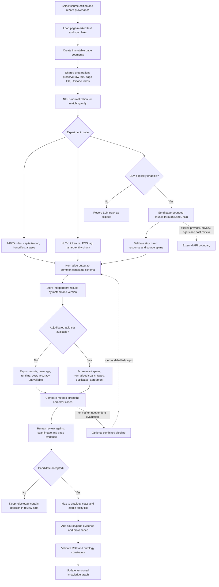

# Persia and the Persian Question: Linked Open Data

[](LICENSE)

This project studies George N. Curzon's *Persia and the Persian Question* as a historical source and develops a structured, RDF-based knowledge graph about the people, places, events, documents, and political relationships it describes.

The aim is to make Curzon's account easier to explore and compare while identifying its omissions, ambiguities, and contested claims. The graph is an analytical aid, not a claim that Curzon's account is neutral or complete. Assertions should be traceable to a source and page wherever possible, and interpretations should be distinguished from facts reported by the source.


## Project Goals

- Treat Curzon's book as unstructured historical data and study reproducible ways to discover, identify, categorize, and extract its entities.
- Compare methods independently before combining them, so their strengths, error patterns, and costs can be measured.
- Preserve edition, page, quotation, method, and review status as provenance for every accepted assertion.
- Map reviewed entities and relations to the project ontology and standard RDF vocabularies.
- Publish reusable Linked Data with stable identifiers, explicit uncertainty, and a clear distinction between Curzon's claims and later interpretation.

## Technologies and Standards


The current ontology is expressed in RDF/OWL. CIDOC CRM, SPARQL querying, SKOS vocabularies, and IIIF presentation are target integrations, not yet implemented in this repository.

## Repository Contents

| Path | Contents |
| --- | --- |
| `ontology/Curzon_Ontology.ttl` | RDF/OWL ontology in Turtle format. It defines classes for people, factions, events, places, time, documents, and source books, plus their properties. |
| `rdf/Integrated_KG.ttl` | Integrated RDF knowledge graph of entities and relationships extracted from Curzon's two volumes. |
| `visualization/visualize_events.py` | PyVis script for an interactive, event-centered graph sample with ontology-class colors and event-link coverage. |
| `visualization/requirements.txt` | Python dependencies for the visualization script. |
| `analysis/review_entities.py` | Page-level heuristic name candidate extraction and comparison with labels already in the RDF graph. |
| `analysis/integrate_review.py` | Adds exact-label page occurrence references from the review CSV using ontology-defined properties. |
| `analysis/requirements.txt` | Python dependencies for the entity review script. |
| `analysis/reports/volume1_entity_review.csv` | Generated page-cited entity review queue; not asserted graph data. |
| `plain_text_books/Curzon_vol1.txt` | Internet Archive full-text page for volume 1. Despite the extension, this file currently contains HTML rather than clean plain text. |
| `plain_text_books/Curzon_vol2.txt` | Internet Archive full-text page for volume 2. Despite the extension, this file currently contains HTML rather than clean plain text. |
| `plain_text_books/Curzon_vol1_djvu.txt` | Raw DjVu-derived OCR text for volume 1, downloaded from the Internet Archive record. |
| `plain_text_books/Curzon_vol2_djvu.txt` | Raw DjVu-derived OCR text for volume 2, downloaded from the Internet Archive record. |
| `plain_text_books/plain_curzon_vol1.txt` | Readable, page-marked transcription of volume 1. Its title matter identifies the text as a Frank Cass 1966 reprint of the 1892 first edition. |

Source records: [Volume 1](https://archive.org/details/in.gov.ignca.11918) and [Volume 2](https://archive.org/details/in.gov.ignca.11917).

## Current Status

The repository contains the ontology, an integrated RDF knowledge graph, Internet Archive page captures, raw OCR derivatives, and a more readable volume 1 transcription. The clean transcription is based on a 1966 reprint, not the 1892 first-edition scan; use it to find candidate entities and passages, then verify readings and cite page evidence against the 1892 scan. Its precise transcription provenance is not yet recorded. The DjVu OCR files are derived from the Internet Archive scans, not independent transcriptions or newly corrected OCR. The graph is not yet published as a dereferenceable Linked Data service, and its source references are generally volume-level rather than precise page citations. The ontology metadata still describes a Browne/Shuster source corpus rather than Curzon; align that metadata and the ontology namespace with this project's scope before presenting the graph as a complete, interoperable release. The current namespace uses GitHub-based IRIs, which should resolve to stable project documentation or data when published.

## Suggested Curation Workflow

1. Use the clean transcription as a search aid where available; retain its edition/provenance details and keep corrections in separate files.
2. Verify candidate entities and events against scan images, recording volume, printed page, scan page, and evidence for each assertion.
3. Represent curated statements in RDF using the ontology, with provenance and uncertainty made explicit.
4. Validate the Turtle and links, then publish the ontology and dataset at stable, dereferenceable URLs.

## Comparative Extraction Study

The project will compare at least three extraction approaches on the same page-marked text:

| Track | Role | Strengths to measure | Risks to measure |
| --- | --- | --- | --- |
| NFKD plus deterministic rules | Baseline candidate discovery using Unicode normalization, capitalization, honorifics, and alias rules. **NFKD is normalization, not an entity recognizer.** | Reproducibility, speed, transparency, no model/API cost. | Misses uncapitalized names and context-dependent identity; capitalization creates false positives. |
| NLTK | Local tokenization, part-of-speech tagging, and named-entity chunking. | Offline operation, repeatability, useful person/location/organization baseline. | Historical names, transliteration variants, and old prose may not fit its training domain; model data must be installed. |
| LangChain with an LLM provider | Page-bounded, schema-constrained candidate extraction and categorization. | Context-sensitive recognition, explanations, and richer categories/relations. | Nondeterminism, hallucinations, latency/cost, provider data handling, and edition/copyright concerns. External calls must be opt-in. |

All methods should emit the same candidate record: method/version, entity text and type, page number, character span where available, exact evidence excerpt, confidence if supported, and review status. A method must not silently add candidates to `Integrated_KG.ttl`.

### Evaluation Indicators

Create a manually adjudicated gold set from stratified pages across narrative, tables, captions, and notes. Keep entity mentions and entity types in separate annotations; record ambiguous cases rather than forcing a label. Use the same pages and gold set for each method.

- Mention precision, recall, and F1 using exact page-and-span matching; report a separately labeled normalized-text score if Unicode or punctuation normalization is allowed.
- Entity-type accuracy on correctly matched mentions, with per-class precision/recall/F1 and a confusion matrix.
- Candidate duplication rate, page coverage, and human acceptance/rejection rate.
- Runtime, pages per minute, setup/model requirements, and (for hosted LLMs) token use and estimated cost.
- Failure examples and adjudicator agreement, not only aggregate scores.

Do not report accuracy until a gold set exists. A candidate count, match rate against the current KG, or confidence emitted by a model is not accuracy.

### Staged Orchestration

Run each method independently first and retain each result set unchanged. An orchestrator/state machine can later manage loading, method execution, evaluation, human review, and graph integration. Only after independent results are measured should a separately identifiable combined pipeline use consensus, rules, or human adjudication. Failed or unavailable methods should be recorded as skipped/failed without discarding successful method outputs.



The hosted LLM branch is disabled by default. Send only necessary page-sized excerpts, never the complete source by default, and review provider terms and source rights before enabling it. Store prompts, model/provider identifiers, parameters, and raw responses separately from accepted RDF assertions.

**Implementation status:** `analysis/review_entities.py` currently implements the deterministic heuristic baseline and emits a review CSV. The comparative NLTK/LLM runners, gold-set scorer, and state-machine orchestrator are experimental/planned until their adapters and tests are in place; the Mermaid diagram describes the target workflow, not a claim that every stage is already implemented.

## Event Graph Preview

The PyVis utility in `visualization/` renders an interactive, event-centered sample from the integrated graph. Events are ranked by their links to agents, places, and time anchors; hover over event nodes to see available links and missing categories.

```powershell
python -m pip install -r visualization/requirements.txt
python visualization/visualize_events.py
```

The output is `visualization/event_sample.html`. Pass `--max-events 0` to include every typed event, or use `--data`, `--ontology`, and `--output` to select other files or a different output path.

## Entity Review

The review utility uses local capitalization and honorific patterns with the page markers in the clean transcription to build a CSV of detected names, existing-label matches, candidate terms, page numbers, and supporting snippets. These rules are heuristic, not named-entity recognition: multiword candidates are more useful, while singleton terms are marked ambiguous. Fuzzy matches are suggestions only; verify candidates against the source scan before changing the graph. `review_entities.py` does not modify RDF files. `integrate_review.py` adds page references only for exact label matches, in a marked generated block; those references document lexical occurrence, not proof of the associated historical claim. Fuzzy and new candidates are not bulk-added.

```powershell
python -m pip install -r analysis/requirements.txt
python analysis/review_entities.py
python analysis/integrate_review.py
```

By default, the report is written to `analysis/reports/volume1_entity_review.csv`. The current page-marked transcription is for volume 1; volume 2 can be reviewed by passing a page-marked text file with `--text`.

## Licensing

The project's original ontology, authored annotations, and knowledge-graph data are licensed under **Creative Commons Attribution 4.0 International (CC BY 4.0)**. See [LICENSE](LICENSE) for the scope and terms. Reusers must provide appropriate attribution, link to the license, and indicate changes.

This license does not cover the files in `plain_text_books/` or other third-party material. The source captures and OCR derivatives are associated with Internet Archive records; the page content, underlying digitized edition, and OCR files may have separate rights or terms. Verify the edition's public-domain status and the source provider's terms in the relevant jurisdiction before redistributing them. Software code, if added, should be licensed separately.

## Contributing

Contributions should include source and page references for historical claims, distinguish reported claims from editorial interpretation, and document uncertainty or disagreement rather than silently resolving it. Keep identifiers stable and validate RDF changes before proposing them.
